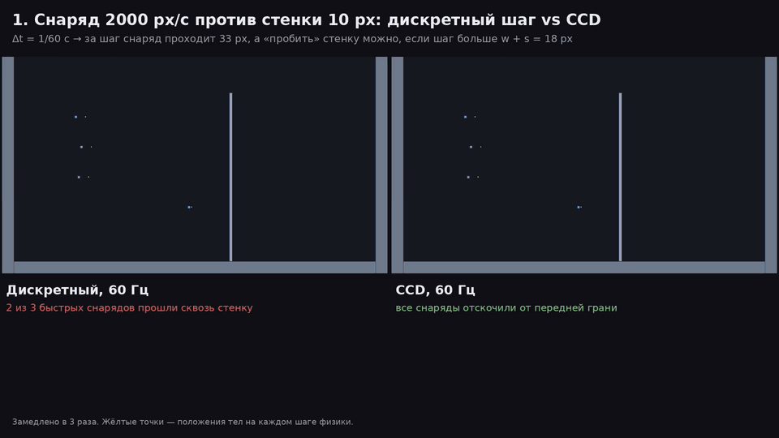

# 2D rigid body: туннелирование, CCD и multi-rate

Упрощённый 2D-движок твёрдых тел (AABB без вращения) для сравнения двух способов борьбы
с туннелированием быстрых объектов:

- **CCD** (Continuous Collision Detection) — поиск момента касания внутри шага методом swept AABB;
- **multi-rate** — обычные тела шагают с частотой 60 Гц, быстрые — в *N* раз чаще (по умолчанию 240 Гц).

Практическое задание 3, блок «Механика», дисциплина «Моделирование физических процессов».



**Видео 26,5 с:** [media/ccd_multirate_demo.mp4](media/ccd_multirate_demo.mp4). В нём сравниваются
дискретный режим и CCD, 60 Гц и multi-rate 60/240, а затем показана основная сцена.

## Результаты

Основная сцена: 9 статичных тел, 50 обычных (из них стек из 10 блоков), 5 быстрых снарядов
по 4000 px/с, залп каждые 1,5 с. Длительность 60 с, всего 205 выстрелов.

| | Дискретный 60 Гц | CCD 60 Гц | Multi-rate 60/240 | Дискретный 240 Гц |
|---|---|---|---|---|
| Проскоки сквозь мишени | 61 % | 0 | 0 | 1,5 % |
| Детерминированность (в т.ч. при случайном FPS) | да | да | да | да |
| Время физики на кадр, 50 тел | ×1,0 | ×2,1 | ×1,3 | ×3,8 |
| Шагов быстрых тел за кадр | 1 | 1 | 4 | 4 |

Минимальный эксперимент из задания: снаряд 2000 px/с, стенка 10 px, Δt = 1/60 с. В дискретном режиме
снаряд проходит сквозь стенку, в CCD сталкивается с ней в точно вычисленный момент, в multi-rate
с подшагом 1/240 с тоже сталкивается.

Подробности, формулы и все замеры приведены в отчёте; исходные данные лежат в `data/`.

## Сборка

Нужны только CMake ≥ 3.21, компилятор C++17 (MSVC, GCC или Clang) и доступ к GitHub.
SDL2 2.30.9 и Dear ImGui 1.91.9 скачиваются и собираются автоматически через CMake FetchContent,
ставить их вручную не нужно.

### Visual Studio 2022 (Windows)

1. *File → Open → Folder…* и выбрать **корень репозитория**, то есть папку, где лежит `CMakeLists.txt`.
   Создавать решение через шаблон *CMake Project* не нужно.
2. В списке конфигураций выбрать **x64 Release** (его задаёт `CMakePresets.json`).
3. Дождаться в окне *Output → CMake* строки *CMake generation finished*. Первый раз это занимает
   1–2 минуты, потому что скачивается и собирается SDL2.
4. В *Select Startup Item* выбрать `physsim.exe`, затем нажать F5 или Ctrl+F5.

Программы собираются в `out/build/x64-release/`.

Если после переноса или переименования папки CMake сообщает, что *CMakeCache.txt directory is different*,
выполните *Project → Delete Cache and Reconfigure* или удалите папку `out/`: в кэше записаны абсолютные пути.

### Командная строка (Windows, Linux, macOS)

```bash
cmake -S . -B build -DCMAKE_BUILD_TYPE=Release
cmake --build build -j --config Release
```

Чтобы собрать только физику и эксперименты, без окна и без SDL2, добавьте `-DBUILD_GUI=OFF`.

## physsim — интерактивное приложение

```bash
./build/physsim                                   # основная сцена, дискретный режим 60 Гц
./build/physsim --mode ccd                        # то же с CCD
./build/physsim --mode multirate --hz 60 --fast-n 4
./build/physsim --scene 4 --hz 60                 # сцена туннелирования: снаряд 2000 px/с против стенки 10 px
```

| Клавиша | Действие |
|---|---|
| M | режим: дискретный → CCD → multi-rate (сцена не перезапускается) |
| F | залп снарядов (основная сцена) |
| 1–7 | сцена: 1 стек, 2 отскок, 3 баллистика, 4 облако тел, 5 туннелирование, 6 смешанная, 7 основная |
| R | перезапуск сцены |
| Space / N | пауза / один шаг физики |
| I | интерполяция отрисовки |
| D | точки положений тел на каждом шаге физики |
| C | нормали контактов |
| H | скрыть панель |
| F12 | скриншот (BMP рядом с программой) |
| Esc | выход |

На панели переключаются режим, частота физики (*Physics Hz*), число подшагов multi-rate (*N*),
скорость снарядов, коэффициент восстановления *e* и трение (раздел *Solver*). Там же показаны
ms/frame, число шагов за кадр и счётчик проскоков.

Ключи командной строки: `--scene K` (0–6), `--mode discrete|ccd|multirate`, `--hz`, `--fast-n`, `--speed`,
`--dots`, `--no-interp`, `--contacts`, `--no-hud`. Для записи кадров без окна: `--record DIR --frames N`,
сценарий команд по времени — `--script "1.5:fire;3:mode-ccd"`.

В сцене туннелирования красный крест отмечает точку удара, найденную CCD. На панели для каждого снаряда
показаны положение первого касания *u* относительно центра стенки и итог: PASSED (прошёл) или BOUNCED (отскочил).

## physbench — эксперименты без окна

Все эксперименты отчёта (результаты складываются в `data/`):

```bash
bash scripts/run_experiments.sh
```

Отдельные запуски:

```bash
./build/physbench tunnel --hz 60 --v 2000 --u -15                  # минимальный эксперимент: проскок
./build/physbench tunnel --hz 60 --v 2000 --u -15 --mode ccd       # то же с CCD: удар
./build/physbench tunnel --mode multirate --hz 60 --fast-hz 240 --v 2000 --u -15
./build/physbench tunnel-sweep --out data/tunnel_sweep.csv         # доля проскоков по скоростям и частотам
./build/physbench ccd-check --runs 2000 --hz 60 --seed 3           # точность момента удара
./build/physbench main-compare --time 60 --out data/main_compare.csv
./build/physbench main-timing --time 20 --reps 15 --out data/main_timing.csv
```

Полный список экспериментов: `physbench` без аргументов; параметры описаны в начале `src/bench/bench_main.cpp`.

## Графики, видео и отчёт

```bash
pip install matplotlib pillow
python scripts/make_media.py build/physsim # видео, GIF и скриншоты (нужен ffmpeg в PATH)
```

Графики отчёта строят скрипты `scripts/plot_*.py`; какие файлы из `data/` они принимают, написано в заголовке
каждого скрипта.

`make_media.py` берёт кадры у самого приложения (`--record`). Каждый кадр — ровно 1/60 с модельного
времени, поэтому видео повторяется кадр в кадр. На Windows путь к программе:
`out/build/x64-release/physsim.exe`.

## Структура

```
src/core     физика без графики: Vec2, Body, контакты AABB, swept AABB, World (дискретный шаг, CCD, multi-rate)
src/scenes   сцены, общие для приложения и экспериментов (в т.ч. основная сцена main_scene.*)
src/app      окно SDL2, отрисовка, панель ImGui
src/bench    physbench: эксперименты без окна, вывод в CSV
scripts      эксперименты, графики, видео (Python + matplotlib, Pillow)
data         результаты экспериментов (CSV и текстовые сводки)
media        видео, GIF и скриншоты
report       генератор отчёта и рисунки (report/fig)
```

## Модель кратко

- Фиксированный шаг с аккумулятором и интерполяцией отрисовки, полунеявный метод Эйлера, *g* = 980 px/с².
- Контакты AABB, последовательные импульсы (10 итераций, warm start), восстановление *e* = 0,5,
  кулоново трение μ = 0,4, позиционная коррекция.
- CCD: момент касания методом slab для относительного движения пары. Тела сдвигаются к самому раннему удару,
  импульс применяется, поиск повторяется на остатке шага (до 8 ударов, для пар, способных проскочить, — до 32).
- Multi-rate: тик обычных тел Δ*t*, затем *N* подшагов Δ*t*/*N* только для быстрых тел. Пары перебираются
  как «быстрое × все», то есть за O(*n*_быстр · *n*).
- Детерминированность: собственный генератор случайных чисел, без `-ffast-math` и FMA (`-ffp-contract=off`,
  `/fp:precise`), хэш состояния FNV-1a для проверки.

Ограничения: тела без вращения (только AABB); CCD считает движение внутри шага прямолинейным;
в multi-rate туннелирование лишь отодвигается до скорости в *N* раз большей, а обычные тела во время
подшагов стоят в положении конца тика.

## Использование ИИ

Код, скрипты и черновик отчёта подготовлены вместе с ИИ-ассистентом Claude (Anthropic).
Результаты проверены запуском программы и сверкой замеров с формулами.
